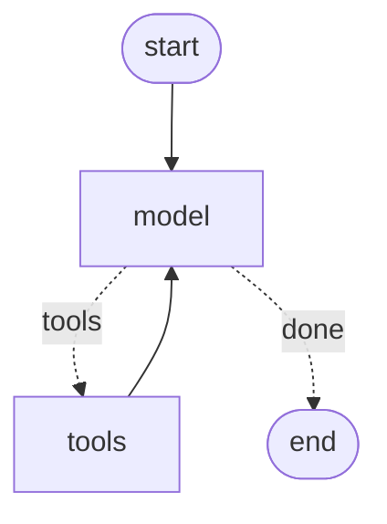

# tiny-agent-graph

A small, dependency-free **state graph** for LLM agent loops, in about 400 lines of Python 3.10+.
It shows the core ideas behind graph-based agent frameworks such as LangGraph — nodes, routed
edges, state reducers, checkpoints and human-in-the-loop interrupts — in code you can read in
one sitting and drop into any project.



## Features

| Feature | How |
|---|---|
| Nodes | plain functions `fn(state)` returning a dict or `None`; they get a deep copy, so they cannot change state by accident |
| State reducers | per key: `overwrite` (default), `append` (chat history), `add` (token / cost counters), `merge_dict` |
| Edges | fixed `add_edge(a, b)` or routed `add_conditional_edges(a, router, {"label": node})` |
| Validation at compile | missing entry, unknown targets, nodes with no exit, unreachable nodes |
| Loop guard | `max_steps` raises `GraphRecursionError` instead of burning tokens forever |
| Retries | `add_node(..., retries=2, retry_on=[TimeoutError], backoff=0.5)` (exponential) |
| Streaming | `for step in app.stream(state)` gives node, update, next node, state, attempts, time |
| Checkpoints | `MemoryCheckpointer` or `JsonFileCheckpointer(dir)` (atomic writes) after every step |
| Human-in-the-loop | `compile(interrupt_before=["tools"])`, then `app.resume(thread_id, update={...})` |
| Crash recovery | a failed run resumes from the last finished step, not from the start |
| Diagram | `graph.to_mermaid()` |

## Quick start

```python
from agent_graph import END, StateGraph, add, append

def call_model(state):
    reply = my_llm(state["messages"])          # any chat API: Claude, Bedrock, ...
    return {"messages": [reply], "llm_calls": 1}

def run_tools(state):
    calls = state["messages"][-1]["tool_calls"]
    return {"messages": [run_tool(c) for c in calls]}

g = StateGraph(reducers={"messages": append, "llm_calls": add})
g.add_node("model", call_model, retries=2, retry_on=[TimeoutError])
g.add_node("tools", run_tools)
g.set_entry("model")
g.add_conditional_edges("model",
                        lambda s: "tools" if s["messages"][-1].get("tool_calls") else "done",
                        {"tools": "tools", "done": END})
g.add_edge("tools", "model")

app = g.compile(max_steps=10)
final = app.invoke({"messages": [{"role": "user", "content": "..."}]})
```

## Human approval before tools run

```python
from agent_graph import JsonFileCheckpointer

app = g.compile(checkpointer=JsonFileCheckpointer(".checkpoints"), interrupt_before=["tools"])
res = app.run(question, thread_id="ticket-42")
# res.status == "interrupted", res.next_node == "tools" -> show the tool call to a person
res = app.resume("ticket-42")                     # approved: run the tools and continue
# or app.resume("ticket-42", update={"messages": [{"role": "user", "content": "Do not do that."}]})
```

The same checkpoint lets a run continue after a crash: call `app.resume(thread_id)` and it
re-runs only the node that failed.

## Run the example and tests

```bash
python3 examples/react_agent.py              # offline ReAct loop with a scripted model + safe calculator
python3 -m unittest discover -s tests -v     # 31 tests, no dependencies
```

The example uses a scripted model so it is repeatable and free; replace `ScriptedModel` with a
real chat API call that returns `{"role": "assistant", "content": ..., "tool_calls": [...]}`.

## Notes

- State must be JSON-serialisable when you use `JsonFileCheckpointer`.
- Thread ids for the file checkpointer are limited to `A-Z a-z 0-9 . _ -` (no path tricks).
- Nodes run one at a time; there is no parallel fan-out. Keep it small on purpose.

## License

MIT © 2026 Sri Ruthuhasa Komma
